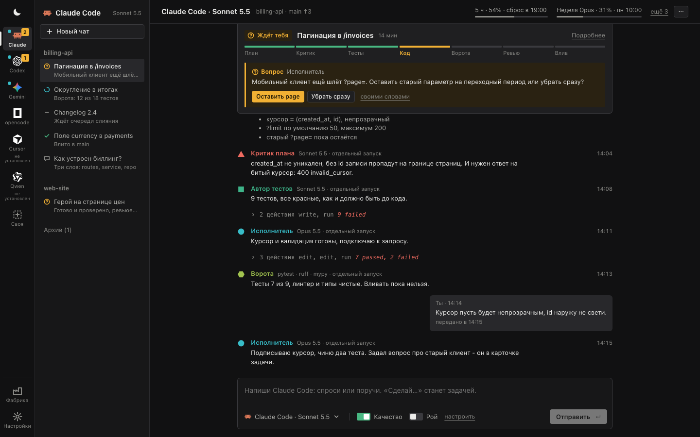
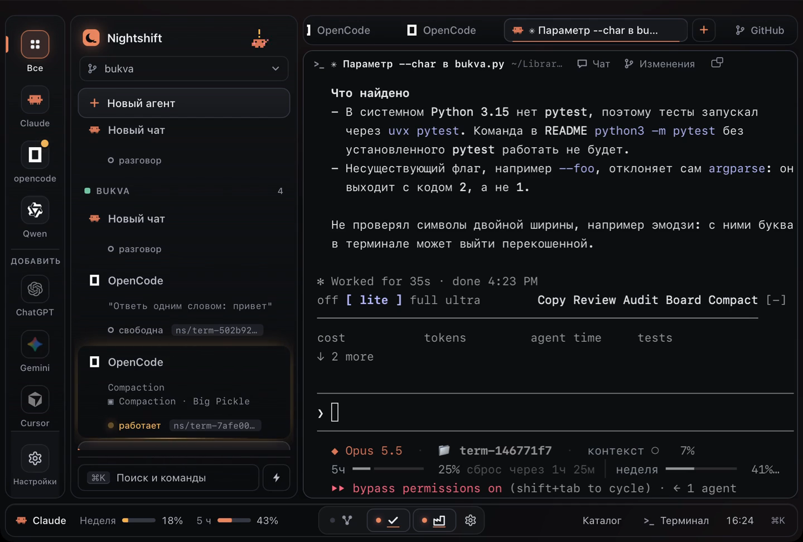
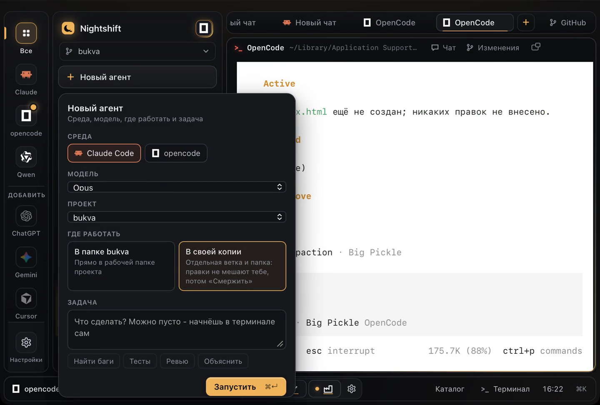
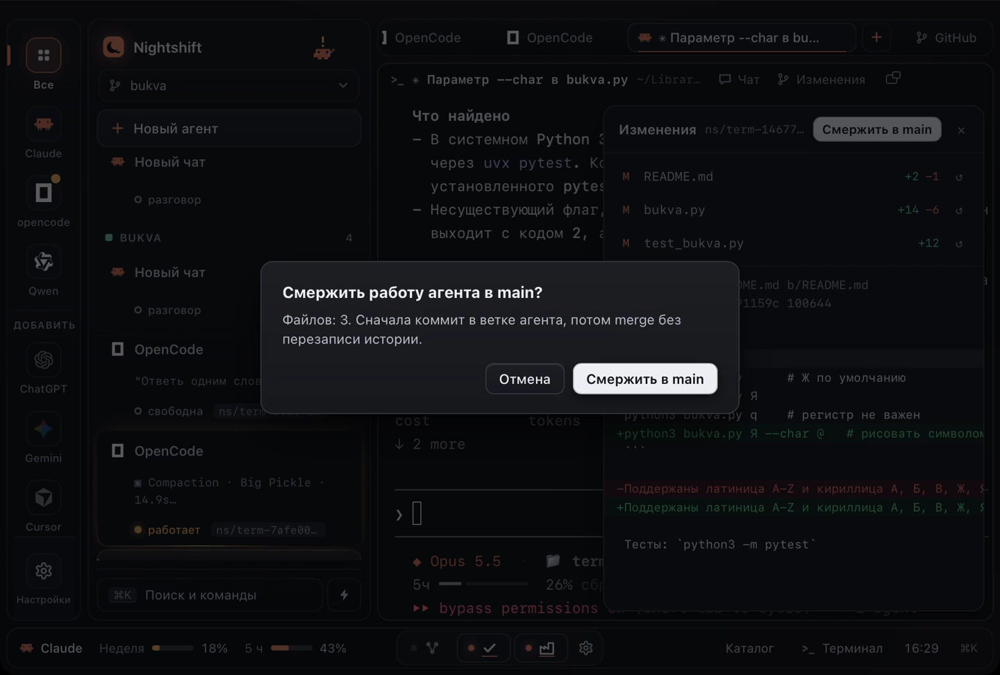
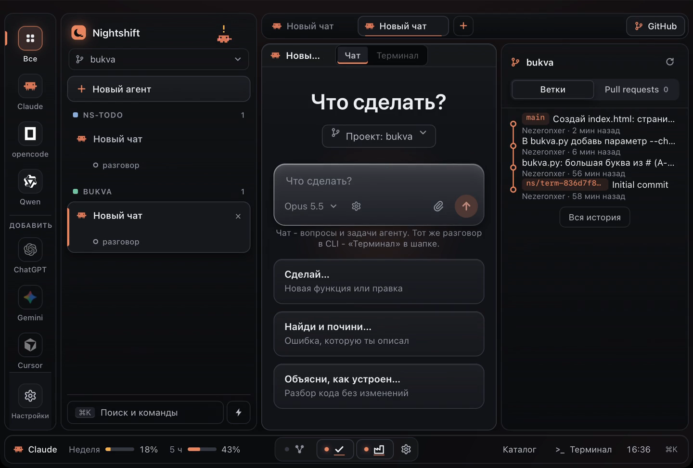
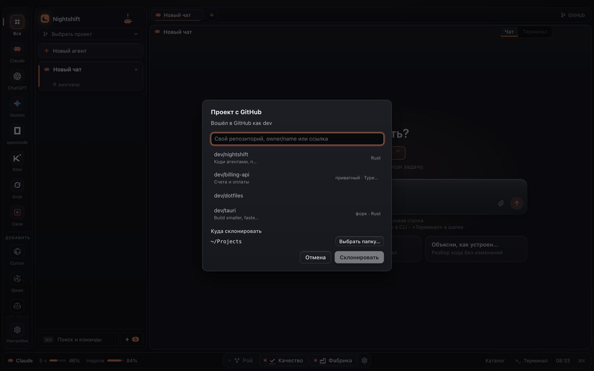
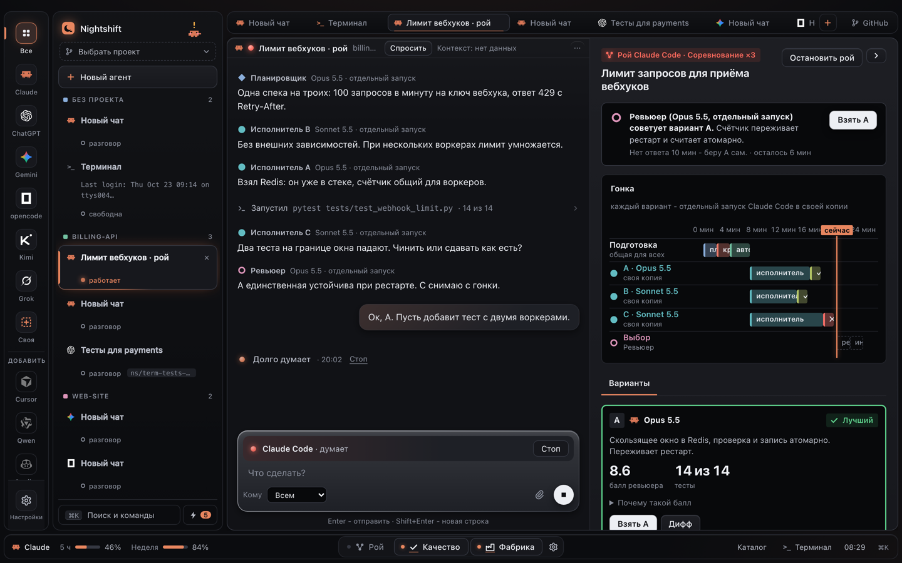
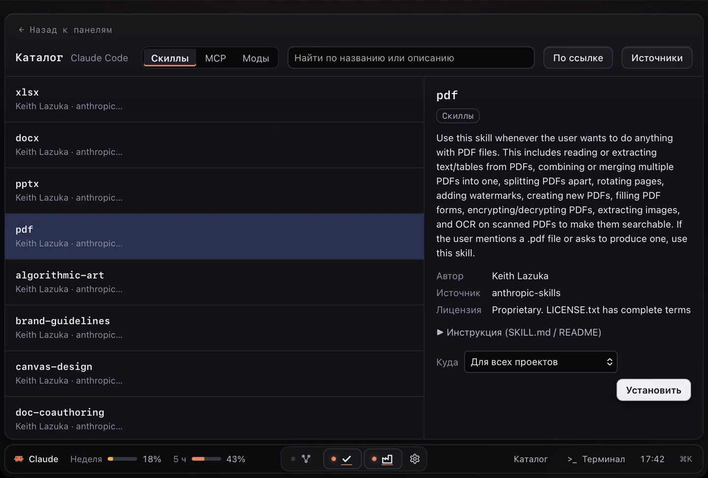

# Nightshift

[English version](README.md)

**Десктопное приложение, которое отдаёт кодинг вашим агентским CLI и молчит, пока не понадобится решение человека.**

> Nightshift - рабочее название (см. [Переименование](#переименование)). Репозиторий: https://github.com/Nezeronxer/vibe-env



На скриншоте главный экран с данными dev-mock, а не реальный проект. Светлая тема -
[`docs/screenshot-main-light.png`](docs/screenshot-main-light.png).

Большинство похожих инструментов - пульт для нескольких параллельных агентов: вы смотрите диффы и вливаете.
Nightshift наоборот: вы описываете работу, агенты делают её в отдельной git-копии, проверяют тестами и независимым
ревьюером, вливают и **зовут вас, только когда что-то нужно именно вам**.

## Как это выглядит

Кадры из живого прогона настоящего приложения на локальном проекте `bukva` (маленькая программа, рисующая букву), кроме
«Роя» и окна «С GitHub…» - они сняты на демо-данных.

**Агент сделал задачу в своей копии проекта.** Слева лента агентов с превью и состоянием, справа его терминал: 37 тестов
прошли, ваша папка не тронута.



**Новый агент в один клик.** Среда, модель, проект и где работать - прямо в папке или в своей копии с отдельной веткой.



**«Изменения» и влив.** Видно каждый изменённый файл и дифф, любой файл откатывается кнопкой, «Смержить в main» -
без перезаписи истории.



**Панель GitHub.** Ветки проекта с тремя вливами агентов и открытые pull request'ы рядом с чатом.



**Проект с GitHub.** Вход один раз через GitHub CLI, свои репозитории с поиском или любой открытый по ссылке - и он
уже проект в `~/Projects`.



**Рой.** Несколько агентов на одну задачу: гонка трёх вариантов, ревьюер выбирает лучший, видно баллы и тесты.



**Каталог скиллов, MCP и модов.** Описание и лицензия из самого скилла, установка в нужный агент.



## Быстрый старт

1. Поставьте хотя бы один агентский CLI (Claude Code, Codex, opencode, Qwen Code, Gemini…). Колонка слева показывает
   установленные; неустановленные собраны под «Добавить» и ставятся оттуда во встроенном терминале.
2. Проект: шапка колонки → «Создать проект…» (имя - и готово: папка в `~/Projects`, git и первый коммит) или
   «Открыть папку…», или «С GitHub…» (один раз войти через GitHub CLI, выбрать свой репозиторий или вставить `owner/name`
   или ссылку на любой открытый - он клонируется в `~/Projects` и становится проектом).
3. «Новый агент»: среда, модель, проект и где работать - «В своей копии» (своя ветка `ns/term-*`, ваши файлы не
   трогаются) или прямо в папке. Пишете задачу → «Запустить».
4. Агент работает в терминале своего CLI. Закончил или спрашивает - карточка «ждёт тебя», системное уведомление,
   ⌘J переводит к нему. В шапке сессии «Чат | Терминал» - тот же разговор чатом или в самом CLI.
5. «Изменения» - что агент поменял (дифф, откат файла) и «Смержить в main».
6. Скиллы и MCP, которые стоят в одном CLI, при запуске сами появляются в остальных (Настройки → Основное →
   «Скиллы и MCP во всех агентах»; там же «Что пропущено и почему» и откат).

## Как работает цикл

1. **Попросить.** В чате среды вы задаёте модели вопрос или пишете «Сделай ...», и это становится задачей в той же ленте.
2. **План.** Планировщик пишет план, критик его атакует (роли - отдельные запуски той же среды, у каждой своя модель).
3. **Сначала тесты.** Автор тестов пишет красные тесты, которые определяют «готово».
4. **Код.** Исполнитель работает в своей git-копии (ветка `ns/*`), пока тесты не пройдут.
5. **Ворота и ревью.** Запускаются проверки проекта, затем независимый ревьюер читает дифф. До 3 кругов ревью.
6. **Влив.** Один сжатый коммит уходит в `main` (или в pull request - по настройке проекта). Если проверка при вливании упала, после свежего rebase она повторяется; конфликт решает отдельный запуск Интегратора.

Вас зовут (системное уведомление со звуком, пометка на значке среды) в трёх случаях: агенту нужно решение, которое
может принять только вы; задача не вышла после всех попыток; нужно разрешение на push. Любую готовую задачу можно
откатить одной кнопкой, одна клавиша замораживает всех агентов. Переключатель «Качество» добавляет шаги улучшения
промпта и проверки; «Рой» ставит на одну задачу несколько агентов (гонка, разбиение на части или совет; от 2 до 5).

## Чем отличается

По разбору 25 похожих продуктов (2026-10-21, заметки - в исследовательских файлах репозитория):

- Большинство показывает диффы и ждёт вас. Среди разобранных на десктопе мы не нашли такого, где тесты, самопроверка,
  независимое ревью и авто-влив идут цепочкой до вызова человека.
- Git worktree - не песочница. Nightshift включает песочницу по умолчанию там, где её даёт CLI (Claude Code), и прямо
  говорит, какие среды работают без технических запретов.
- Продолжение после сброса лимита есть у Claude Code Desktop; разобранные продукты не переключают модель при лимите.
  Nightshift переключается на другую модель **той же среды**.
- Local-first: данные - обычные файлы, без телеметрии и без своего сервера (как у Backlog.md и Paseo).
- Linux - полноправная платформа, а у большинства аналогов это слабое место.

Что взяли у других: worktree на задачу (у всех), несколько CLI через адаптеры (Claude Squad, Superset, Orca), копирование
`.env` в стиле `.worktreeinclude` (Claude Code Desktop), задача из чата одной фразой (Emdash, Terragon), очередь
вливания и свежий агент на конфликт (Gas Town), время сброса лимита на экране (Orca).

## Поддерживаемые среды

«Проверено» - флаги и форматы вывода сверены с настоящей CLI на машине разработки. «По документации» - взято только
из документации вендора и не запускалось.

| Среда | Статус | Песочница и запрет push |
|---|---|---|
| Claude Code | проверено | песочница включена, push / remote / sudo запрещены флагами |
| opencode | проверено | приложение ничего не навязывает |
| Qwen Code | проверено | приложение ничего не навязывает |
| Codex | по документации | приложение ничего не навязывает |
| Gemini CLI | по документации | приложение ничего не навязывает |
| Cursor | по документации (имя бинаря `agent` не подтверждено) | приложение ничего не навязывает |
| Своя команда | - | приложение ничего не навязывает |

Среды без технических запретов удерживаются в рабочей копии только инструкциями; перед первой задачей приложение
один раз предупреждает. Среды не смешиваются: ревьюер, запасная модель и каждый участник роя - из среды задачи.

Не подтверждено даже у проверенных: лимиты показываются только у Claude Code (окна 5 часов и неделя, по событиям самой
CLI); у остальных приложение пишет «нет данных», а не угадывает. Флаги «только чтение» у opencode и Qwen Code не
подтверждены, поэтому роли только для чтения работают в выбрасываемой копии. Списки моделей Claude Code, Gemini CLI
и Qwen Code - встроенная подсказка (из документации вендоров, с CLI не сверена) плюс «Своя модель».

## Лимиты

- Бюджеты на задачу и на день (по умолчанию 5 и 40 USD, настраиваются). Бюджет задачи передаётся Claude Code как `--max-budget-usd`.
- При лимите подписки задача ждёт сброса или продолжается на запасной модели той же среды.
- Настройка ночного окна (по умолчанию 23:00-08:00) и сводка «Пока тебя не было» о том, что случилось в ваше отсутствие.
- Параллельных задач по умолчанию 3.

## Перенос среды («Наборы»)

Внутри одной машины переносить ничего не нужно: раскладка при запуске копирует в каждый установленный CLI скиллы и
MCP-серверы, которых у него нет, в его собственном формате. Своё у CLI не заменяется (совпало имя - пропуск с
причиной), перед записью делается снимок, «Откатить последнюю» возвращает файлы байт-в-байт. Секреты серверов
кладутся в системную связку ключей, в конфиг - ссылка на переменную.


Ставите приложение и свои агентские CLI - они работают со своими каталогами, как раньше. Чтобы передать свою среду
другой машине или человеку, экспортируйте **набор** (скиллы, правила, хуки, MCP, субагенты) папкой, zip или
git-репозиторием и сделайте **Импорт** с другой стороны.

- Набор ставится только в свою среду (набор Claude Code не ставится в Codex).
- Секреты не переезжают: вы вводите их сами; они хранятся в системной связке ключей.
- Хуки, MCP, скиллы со скриптами и настройки, запускающие программы, ставятся **выключенными**; вы включаете их по одному.
- Перед каждой установкой делается снимок, откат - одной кнопкой.
- У Cursor группы наборов недоступны, пока раскладка не сверена (скиллы Codex, Gemini, Qwen и субагенты Codex тоже помечены «раскладка не сверена»).

## Безопасность

Подробности и карта аудита: [`docs/security.md`](docs/security.md) (на английском).

- Работа идёт в отдельной git-копии; приложение не делает force-push, не делает `reset --hard` по вашим веткам, удаляет только ветки `ns/*` и обновляет вашу рабочую копию только fast-forward на чистой базовой ветке.
- `.env*`, ключи и `~/.ssh` никогда не коммитятся.
- Текст задач, файлов, диффов и чужих наборов передаётся агентам как помеченные данные, а не инструкции.
- В приложении нет телеметрии и своего эндпоинта. Исходящее: ваши агентские CLI, git/gh и загрузка набора по ссылке, которую вы дали.
- Окно получает минимум возможностей Tauri и CSP без внешних источников.
- Среды кроме Claude Code работают без технических ограничений (см. выше).

## Добавить свою среду

- **Своя команда** (без кода): добавьте свою среду в настройках. В шаблоне команды доступны `{prompt}`, `{cwd}` и `{session}`; они приходят в команду безопасными позиционными аргументами, а не вставляются в строку оболочки. Вывод - текст, код 0 - успех; сообщение о лимите ищется в последних 5 строках.
- **Адаптер** (Rust): реализуйте трейт `Adapter` в `core/src/agent/` рядом с существующими (Claude, Codex, Gemini, opencode, Cursor, Qwen) и добавьте его в `adapters()`. Каждый флаг, который не удалось запустить самому, помечайте как непроверенный. См. [CONTRIBUTING.md](CONTRIBUTING.md).

## Установка

Windows 10/11 x64, macOS (Apple silicon и Intel) и Linux x86_64. Скачать: [https://github.com/Nezeronxer/vibe-env/releases/latest](https://github.com/Nezeronxer/vibe-env/releases/latest).

**Windows:** скачайте `Nightshift_<версия>_x64-setup.exe` (или `.msi`) и запустите - ставится для вашего пользователя,
без прав администратора. Сборка пока не подписана, поэтому SmartScreen может написать «Система Windows защитила ваш
компьютер»: «Подробнее» → «Выполнить в любом случае». Нужны git ([git-scm.com](https://git-scm.com/download/win)) и хотя
бы один CLI агента; для «С GitHub…» ещё GitHub CLI (`winget install --id GitHub.cli`). Терминал внутри приложения - PowerShell.

Одной строкой (скрипт скачивает последний релиз, сверяет SHA-256 с `SHA256SUMS` из того же релиза и ставит). Сумма защищает от битой загрузки, **не** от подмены релиза: оба файла лежат в одном месте. Доверие - к репозиторию и странице релиза:

```sh
curl -fsSL https://raw.githubusercontent.com/Nezeronxer/vibe-env/main/scripts/install.sh | sh
```

macOS и Linux. Скрипт можно сначала прочитать:
[`scripts/install.sh`](scripts/install.sh). Он выбирает формат по дистрибутиву: `.deb` для семейства Debian и `.rpm`
для Fedora/openSUSE (печатает команду с `sudo`, сам sudo не вызывает), для остальных - AppImage в `~/.local/bin`
и запись `.desktop`.

**Вручную:** скачайте со страницы Releases (https://github.com/Nezeronxer/vibe-env/releases): `-setup.exe` / `.msi` (Windows), `.dmg` (macOS), `.AppImage` (любой Linux), `.deb`,
`.rpm`. Сверьте файл с `SHA256SUMS` из того же релиза (так ловится порча, не подмена релиза).

**macOS и отсутствие подписи.** Сборка для macOS пока не подписана и не нотаризована (нужен платный аккаунт Apple
Developer). Если macOS не открывает приложение, снимите флаг карантина:

```sh
xattr -dr com.apple.quarantine /Applications/Nightshift.app
```

**Библиотеки Linux.** `.deb` и `.rpm` их объявляют. Для AppImage на минимальной системе поставьте WebKitGTK 4.1
и appindicator:

| Дистрибутив | Пакеты |
|---|---|
| Debian, Ubuntu | `libwebkit2gtk-4.1-0 libayatana-appindicator3-1` |
| Fedora | `webkit2gtk4.1 libappindicator-gtk3` |
| Arch | `webkit2gtk-4.1 libayatana-appindicator` (PKGBUILD - в [`app/installer/aur/`](app/installer/aur/PKGBUILD)) |

Нужны также git и агентские CLI, которыми вы хотите пользоваться (Nightshift их запускает, но не поставляет).

## Сборка из исходников

Нужны: Rust stable (cargo 1.96 или новее), git, Tauri CLI (`cargo install tauri-cli --version "^2"`).
На Debian/Ubuntu ещё: `build-essential pkg-config libssl-dev libxdo-dev librsvg2-dev libwebkit2gtk-4.1-dev libayatana-appindicator3-dev`.

```sh
cargo test --workspace           # тесты
cargo build -p nightshift-app    # собрать оконное приложение
cd app && cargo tauri dev        # запуск для разработки
cd app && cargo tauri build      # установщики в target/release/bundle/
```

`ui/` - обычные HTML, CSS и JavaScript без сборщика. Быстрая проверка интерфейса без окна: `node scripts/ui-selftest.js`.
CI: `.github/workflows/ci.yml` (тесты на macOS и Ubuntu, сборка приложения на Windows), `.github/workflows/release.yml` (установщики по тегу `v*`, черновик релиза).
Чтобы позже подписывать сборки macOS, задайте секреты репозитория с именами из `release.yml`.

## Что не сделано и что вне рамок

Не доделано:

- Пакеты Linux (`.deb`, `.rpm`, AppImage) собираются только в CI; автор не запускал их на железе с Linux. `.dmg` для macOS собран локально.
- Очередь ответов чата и «ожидание лимита» живут в памяти: после перезапуска используйте «Повторить». Цепочки запасных моделей при отказе модели в чате нет.
- В рое лимит подписки ставит на паузу всю задачу, а не одну полосу. Best-of-N для рискованных задач не построен.
- Защита от повторной отправки одного сообщения чата живёт в памяти: после перезапуска повтор создаст второй чат.
- На macOS предупреждение о заблокированных уведомлениях приходит редко.
- Codex, Gemini CLI и Cursor с этим приложением не запускались (см. таблицу выше).

Вне рамок сознательно: мобильный и веб-клиенты; контейнеры (песочница CLI, worktree и выбрасываемые копии
закрывают главное); встроенный редактор и терминал (дифф только для чтения, «продолжить в терминале» открывает
терминал); запуск задач из командной строки; перевод наборов между средами; собственные оценки лимитов для сред,
которые их не сообщают; Flatpak (AppImage покрывает остальные дистрибутивы); подпись macOS (нужен ваш аккаунт Apple).

## Чек-лист публикации

Репозиторий не публикуется, пока не отмечено всё; если пункт выполнить нельзя, публикации нет, а причина записана.

- [x] Аудит безопасности закрыт (`docs/security.md`, раздел «Audit report» заполнен; каждая находка исправлена или объяснена)
- [x] `gitleaks` по всей истории чист (29.10.2026: 13 срабатываний - тестовые фикстуры и слова интерфейса; trufflehog: живых секретов нет)
- [x] `README.md`, `README.ru.md` и `LICENSE` на месте
- [ ] CI собирается (`ci.yml` зелёный; тестовый тег дал черновик релиза)
- [x] Заглушки заполнены: `<OWNER>`, `<REPO>`, `<REPO_URL>`, `<SECURITY_CONTACT>`, `<MAINTAINER ...>` в PKGBUILD
- [ ] Условия на значки перепроверены ([`docs/icons-sources.md`](docs/icons-sources.md))

## Переименование

Название - допущение. Поменяйте `productName` и заголовок окна в `app/tauri.conf.json`, название в словарях
`ui/i18n.js` и `ui/i18n-v2.js` и `APP_NAME` в `scripts/install.sh`. Название также встречается в документах
и нескольких идентификаторах (`nightshift-core`, `nightshift-app`).

## Товарные знаки и лицензия

Trademarks belong to their owners and are used only to identify compatible products.
Товарные знаки принадлежат владельцам и используются только для обозначения совместимых продуктов.
Источники и условия каждого значка: [`docs/icons-sources.md`](docs/icons-sources.md).

Лицензия [MIT](LICENSE). Как участвовать: [CONTRIBUTING.md](CONTRIBUTING.md).
